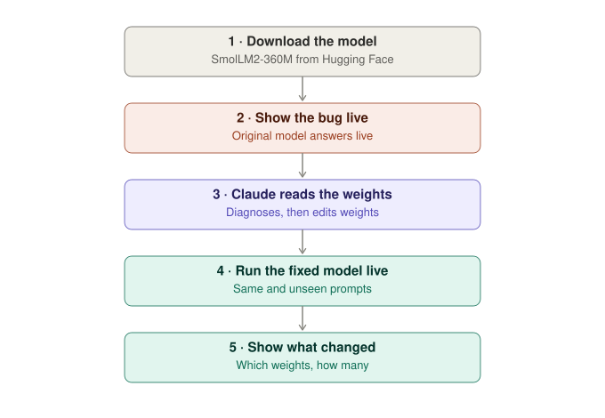

# Loop Repair

**Fixing a language model by editing its weights, with no training.**

A small open model, [SmolLM2-360M-Instruct](https://huggingface.co/HuggingFaceTB/SmolLM2-360M-Instruct), often gets
stuck repeating itself when it decodes greedily. In this repo a large LLM (Claude Code) is handed the weights, a small
toolkit and a budget of 20 model runs. It finds which parts of the network drive the loop and edits those numbers
directly. Then the edit is checked on prompts it never saw.

It's a hands-on reproduction of the idea in
[Sparks of Weight-Space Programming](https://rikiyat.github.io/blog/weight-space-programming/) (MIT CSAIL),
where a large model fixed a small Qwen model's thinking loops by changing 0.016% of its weights.

<p align="center"></p>

## Quick start

You need Python 3.10+ and PyTorch. A CUDA GPU with 4 GB or more is recommended; CPU works but is about 10x slower.
With [uv](https://docs.astral.sh/uv/):

```bash
uv venv --python 3.12
uv pip install torch --index-url https://download.pytorch.org/whl/cu128   # CUDA build; drop the index URL for CPU
uv pip install -r requirements.txt
```

Activate it with `.venv\Scripts\activate` (Windows) or `source .venv/bin/activate` (macOS/Linux), or prefix every
command with `uv run`. With plain pip, install PyTorch for your platform from [pytorch.org](https://pytorch.org)
first, then run `pip install -r requirements.txt`.

## Steps

**1. Download the model** (about 724 MB, into `models/original`):

```bash
python 01_download.py
```

**2. See the bug.** The model answers live, token by token, and sentences it has already written turn red:

```bash
python 02_show_bug.py
python 02_show_bug.py --prompt "Write a poem about the moon."
```

**3. Let a large LLM fix it.** Reset the budget, start [Claude Code](https://claude.com/claude-code) in this folder and
paste the prompt below. It follows the rules in [`CLAUDE.md`](CLAUDE.md), uses `03_toolkit.py`, writes its edit to
`work/edit.py` and builds `models/edited`.

```bash
python 03_toolkit.py budget --reset 20
claude
```

```
This folder contains SmolLM2-360M-Instruct, a small language model that keeps getting stuck repeating
itself. Read CLAUDE.md first. Then find the cause by examining the model's weights and behaviour, and fix it
by editing the weights directly. No training. You have 20 forward-pass runs. Explain what you're doing
as you go, and finish with a short report.
```

Any other agent that can run shell commands works too: point it at `CLAUDE.md`.

**4. Check the fix.** Run the same prompt on the edited model, then compare both models side by side on held-out
prompts, short factual questions and perplexity:

```bash
python 02_show_bug.py --model edited
python 04_compare.py
```

**5. See exactly what changed.** A tensor-by-tensor diff of the two weight files, with charts saved to `work/report/`:

```bash
python 05_weight_diff.py
```

Delete `models/edited/` and `work/` to start over.

## The rules for the corrector

From [`CLAUDE.md`](CLAUDE.md):

- **Edit weights only.** No fine-tuning, gradients, optimizers or LoRA, and no changes to decoding (such as a
  repetition penalty). `03_toolkit.py apply` refuses edits that use gradients.
- **20 model runs.** Reading the weights is free; running the model costs budget, like the paper's forward-pass limit.
- **No peeking at the test.** The held-out prompts in `heldout/` are blocked for Claude Code by
  `.claude/settings.json`, so the final check measures whether the fix generalizes.
- **Small and explainable.** Change as few weights as possible and say what each change does.

## The toolkit

| Command | Cost | What it does |
|---|---|---|
| `python 03_toolkit.py info` | free | Architecture, tensor names, head layout, parameter count |
| `python 03_toolkit.py stats --pattern o_proj` | free | Per-tensor statistics |
| `python 03_toolkit.py heads --layer 0` | free | Per-head weight norms for one layer |
| `python 03_toolkit.py probe [--model edited]` | 1 run | Greedy answers to 12 practice prompts, with loop detection |
| `python 03_toolkit.py attention` | 1 run | Per-head score for "attends to what came next the last time these words appeared" |
| `python 03_toolkit.py show 3` | free | Print one saved probe answer in full |
| `python 03_toolkit.py apply work/edit.py` | free | Build `models/edited` from the original plus an `edit(W)` function |
| `python 03_toolkit.py budget [--reset 20]` | free | Show or reset the run budget |

## Result from the video run

In the recorded run, Claude probed the model, measured attention, and found induction (copy) heads that look back
much harder at "what came next last time" in looping answers than in normal ones. It halved the output of five of
them (17.8, 24.10, 20.8, 24.1 and 18.11), changing **307,200 of 361,821,120 weights (0.085%)**, and used **10 of
its 20 runs**. On the 12 practice prompts, loops went from 4 to 1 and answers that finished on their own went
from 5 to 10.

The edit, Claude's own side-effect check, the budget log and the weight-diff charts are in
[`results/video_run/`](results/video_run/). Your own run may find a different edit: the corrector is an LLM, and
it chooses its own path.

## What counts as a loop

Greedy decoding (always the most likely token), no repetition penalty, at most 512 new tokens. An answer counts as
looping if it ends in 3 or more exact back-to-back copies of the same chunk, or if it runs out of tokens while at
least 20% of its sentences repeat earlier ones. Digits are ignored, so "16. The colors…" and "17. The colors…"
count as the same sentence.

## Limits

- **Weight editing removes obstacles; it doesn't add knowledge.** It works here because the model can already
  answer and the loop gets in the way. The paper reports the same: no gains on a model that didn't have the problem.
- **The test is small:** 12 practice prompts, 12 held-out prompts, 6 factual questions, greedy decoding only.
  It's a demo, not a benchmark.
- **Silencing heads has side effects.** Copy heads are also useful (for example, for repeating a name correctly),
  which is why `04_compare.py` checks factual answers and perplexity, and why a gentle scale can be better than zero.

## Repository layout

```
01_download.py      Download SmolLM2-360M-Instruct from Hugging Face
02_show_bug.py      Live, token-by-token answer with repeats highlighted
03_toolkit.py       The corrector's tools (inspect, probe, attention, apply, budget)
04_compare.py       Original vs edited: live race, held-out prompts, factual questions, perplexity
05_weight_diff.py   Tensor-by-tensor diff with charts
common.py           Loading, greedy generation, loop detection, streaming, run budget
CLAUDE.md           Rules and tool guide for the corrector
heldout/            Held-out prompts for the final check (hidden from the corrector)
.claude/            Claude Code settings that block reading the held-out prompts
results/video_run/  The edit and artifacts from the recorded run
docs/               Video script and diagram
```

## Credits

- Idea: *Sparks of Weight-Space Programming* by Takehi, Teoh, Zhang and Khattab (MIT CSAIL):
  https://rikiyat.github.io/blog/weight-space-programming/
- Model: [SmolLM2-360M-Instruct](https://huggingface.co/HuggingFaceTB/SmolLM2-360M-Instruct) by Hugging Face,
  Apache 2.0. The weights are downloaded at run time and are not included in this repository.

## License

The code in this repository is released under the [MIT License](LICENSE). The model weights it downloads are
covered by their own license (Apache 2.0).
