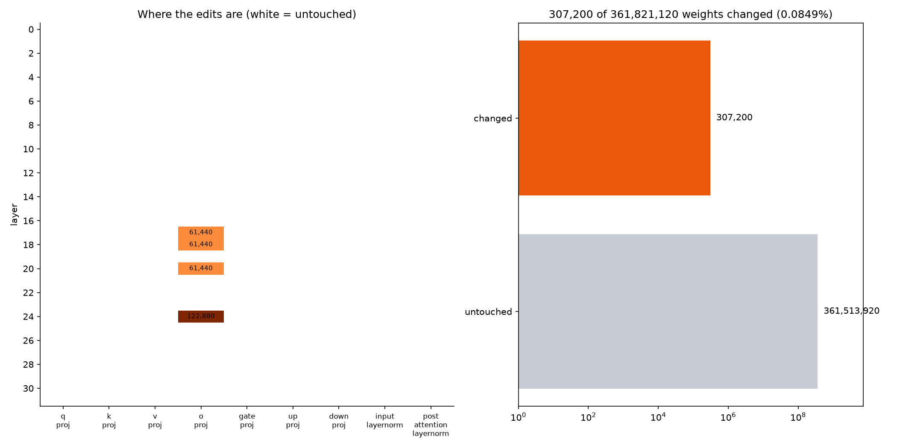
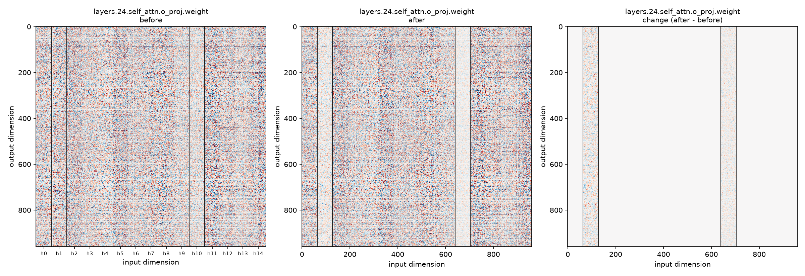

# The run recorded for the video

These are the files Claude Code produced while fixing the model on camera. They're kept as a record;
`models/` and `work/` are not in the repository, so you can reproduce or redo the run yourself.

| File | What it is |
|---|---|
| `edit.py` | The edit Claude wrote: scale the output of five attention heads by 0.5 |
| `sanity.py` | A side-effect check Claude wrote itself: does the edit break legitimate copying or simple facts? |
| `budget.json` | Every model run Claude spent, with timestamps: 10 of the 20 allowed |
| `probe_original.json`, `probe_edited.json` | Greedy answers to the 12 practice prompts, before and after the final edit |
| `attention_original.json`, `attention_edited.json` | Per-head "copy what came next last time" scores (32 layers x 15 heads) |
| `weight_diff.json`, `weight_diff.png`, `changed_matrix.png` | Output of `05_weight_diff.py`: what changed, where, by how much |

## The edit

Claude found heads whose attention jumps to "the token that followed the last time this pair of words
appeared", much more strongly in looping answers than in normal ones (induction / copy heads). It halved
their contribution to the residual stream by scaling their slice of `o_proj` by 0.5:

| Layer.head | Tensor slice |
|---|---|
| 17.8 | `model.layers.17.self_attn.o_proj.weight[:, 512:576]` |
| 24.10 | `model.layers.24.self_attn.o_proj.weight[:, 640:704]` |
| 20.8 | `model.layers.20.self_attn.o_proj.weight[:, 512:576]` |
| 24.1 | `model.layers.24.self_attn.o_proj.weight[:, 64:128]` |
| 18.11 | `model.layers.18.self_attn.o_proj.weight[:, 704:768]` |

**Weights changed:** 307,200 of 361,821,120 (0.085%) in 4 of 290 tensors.

To rebuild the edited model from this file:

```bash
python 01_download.py
python 03_toolkit.py apply results/video_run/edit.py
```

## Practice prompts, before and after

From `probe_original.json` and `probe_edited.json` (12 prompts, greedy decoding, 512 tokens max):

| | Original | Edited |
|---|---|---|
| Answers stuck in a loop | 4 | 1 |
| Answers that finished on their own | 5 | 10 |




